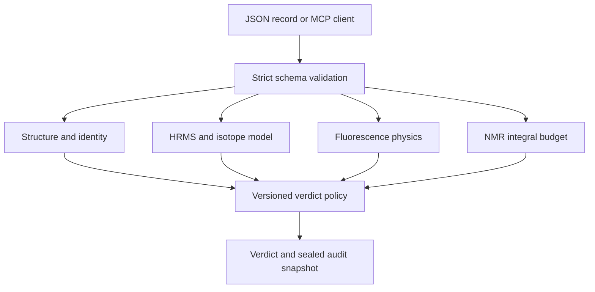

# OpenChemProof

**Deterministic analytical evidence auditing and structured negative results for chemistry agents.**

OpenChemProof separates an agent's interpretation from reproducible chemical calculations.
RDKit and explicit physical models check structure assertions, HRMS adducts and isotope ratios,
fluorescence artifacts, and calibrated NMR integral budgets. Every verification call records the
input, policy, results and software versions in a schema-validated, content-addressed audit snapshot.

**v0.1 is a research foundation.** `VERIFIED` means the supplied evidence passes the implemented
consistency checks; it does not prove molecular identity, synthesis success, purity or biological
activity. `INCONCLUSIVE` is an intentional outcome when essential evidence is missing.

## What is included

- Four deterministic audit engines; strict Pydantic v2 models and JSON Schema.
- Five typed FastMCP tools, two resources, stdio and Streamable HTTP.
- JSON and lossless Parquet exports with SHA-256 integrity checks.
- **500 synthetic integration fixtures**, balanced across the requested five categories.
- **500 real public-source records**, 100 per source category, with original evidence and licenses.
- An async OpenAI-compatible evaluation harness for LLM-alone versus LLM-with-MCP runs.
- A locked `uv` environment, unit/property/integration tests and GitHub Actions configuration.

## Architecture



LLMs can request calculations and explain flags; they do not compute or overwrite the engine's
chemical properties. No model or network access is needed for local verification or oracle tests.

## Quickstart

From the extracted repository directory, install [uv](https://docs.astral.sh/uv/getting-started/installation/):

```bash
uv sync --locked --all-extras --python 3.12
uv run openchemproof verify examples/ethanol.json
uv run openchemproof verify examples/ife_artifact.json
uv run pytest -q
uv run ruff check src benchmarks tests
uv run mypy
```

The lockfile was exercised with Python 3.12.14, RDKit 2026.09.2, Pydantic 2.14.3 and FastMCP 4.2.0.
The package requires Python ≥3.12; other Python versions have not been exercised in this build.
The optional `llm` extra installs the OpenAI client. Omit `--all-extras` for offline-only use.

```bash
uv run openchemproof schema > verification.schema.json
uv run openchemproof check-audit .openchemproof/audits/REPLACE_WITH_DIGEST.json
uv build
```

`OPENCHEMPROOF_AUDIT_DIR` chooses the audit directory. Identical input/policy/runtime/result
snapshots have the same digest and are deduplicated. Existing content is never overwritten;
modified existing content causes an error. Read-only files plus hashes provide tamper evidence,
**not absolute immutability against the filesystem owner**. An external WORM store and signed
manifest would be needed for stronger archival guarantees. Failed input schema validation is an
input error, not a completed verification run.

## Chemical checks and scope

| Engine | Implemented behavior | Important boundary |
|---|---|---|
| Structure | Salt/counterion tracking, neutral parent and as-drawn masses, formula assertions, InChIKey blocks, R/S and E/Z comparisons, canonical tautomer families, PAINS/Brenk, aggregation heuristic | Risk alerts alone do not establish interference; unexplained multicomponent mixtures and permanent ions abstain |
| HRMS | Eight singly charged adducts, dimers, 5 ppm gate, 3 ppm alternative matching, supplied starting-material alternatives, nominal M/M+1/M+2 convolution | Isobaric structures can be indistinguishable; MS2 peaks cannot replace MS1 isotope envelopes; no charge-state deconvolution or raw-spectrum peak picking |
| Optical | Sample/reference IFE correction, QY bounds, Stokes/scatter checks, optional Raman reference and solvent-series trend | Requires declared right-angle center-view geometry; max OD 1.0 by policy; no instrument-specific radiative-transfer model |
| NMR | Formula-derived nonexchangeable/exchangeable H, solvent-specific budgets, calibrated integral balance, impurity candidates, carbon resonance upper bounds | Assigned shifts are not measured integrals; coincident solvent peaks are not definitive contamination; no structure elucidation |

For fluorescence ratios, both sample and reference corrections are necessary:

\[
F_{corr}=F_{obs}10^{(A_{ex}+A_{em})/2},\qquad
R_{corr}=R_{obs}10^{(A_{ex,s}+A_{em,s}-A_{ex,r}-A_{em,r})/2}.
\]

The 0.15 OD trigger and 15% baseline window are configurable screening policies, not universal
physical constants. High absorbance alone does not prove an IFE artifact. DMSO-d6 often preserves
OH/NH signals but does not guarantee their visibility; explicit exchange observations narrow the
allowed budget. Positive mass matches do not distinguish equal-formula isomers.

See [scientific scope](docs/SCIENTIFIC_SCOPE.md) for assumptions, sources and failure modes.

## MCP setup

Local client configuration; replace the repository path with your absolute path:

```json
{
  "mcpServers": {
    "openchemproof": {
      "command": "uv",
      "args": ["--directory", "/absolute/path/openchemproof", "run", "openchemproof-mcp"],
      "env": {"OPENCHEMPROOF_AUDIT_DIR": "/absolute/path/openchemproof/.openchemproof/audits"}
    }
  }
}
```

```bash
uv run openchemproof-mcp --transport http --host 127.0.0.1 --port 8000
# Streamable HTTP endpoint: http://127.0.0.1:8000/mcp
```

Tools take one `record: VerificationRecord` and return an `AuditVerdict`:

1. `verify_structure_identity`
2. `audit_lcms_spectrum`
3. `audit_optical_spectrum`
4. `audit_nmr_consistency`
5. `run_full_verification_pipeline`

Resources: `openchemproof://schema/v1` and `openchemproof://reference/contaminants`.
Modality-specific tools require their evidence object. All tools persist an audit snapshot.
HTTP binds to loopback by default; this prototype does not configure remote authentication.

## chem-artifact-bench: synthetic integration suite

```bash
uv run chem-artifact-generate
uv run chem-artifact-eval --oracle
# --dry-run is an alias for --oracle
```

| Category | Fixtures | Construction |
|---|---:|---|
| STEREO_TAUTOMER_TRAP | 100 | 40 R/S inversions, 20 missing stereo, 20 E/Z swaps, 20 salt/parent mass errors |
| LCMS_ADDUCT_DIMER_TRAP | 100 | 40 sodium misassignments, 20 dimers, 20 absent halogen signatures, 20 starting-material alternatives |
| OPTICAL_IFE_ARTIFACT | 100 | 35 simulated turn-off, 35 simulated turn-on, 20 scatter overlaps, 10 invalid QYs |
| NMR_SOLVENT_INTEGRAL_TRAP | 100 | 40 exchange-rule errors, 60 synthetic contaminant/integral inflation cases |
| VERIFIED_TRUE_AND_NEGATIVE | 100 | 60 clean consistency controls including tautomer equivalents; 40 documented synthetic failures |

Construction-time labels are stored outside model-visible records. The oracle checks both status
and required diagnostic flags and exits nonzero on disagreement. It never rewrites labels to match
predictions. Several generation primitives are shared with the verifier, and structures repeat;
the oracle is a regression/integration check, **not an independent scientific benchmark**.

| Executed mode | Cases | Exact status agreement | Artifact precision / recall / F1 | Artifact acceptance |
|---|---:|---:|---:|---:|
| Deterministic oracle | 500 | 500/500 | 1.000 / 1.000 / 1.000 | 0.000 |
| LLM alone | Not run | — | — | — |
| LLM + MCP | Not run | — | — | — |

Machine-readable results and per-case audit snapshots are under
[`benchmarks/chem_artifact_bench/results/oracle/`](benchmarks/chem_artifact_bench/results/oracle/).
Precision/recall/F1 treat `ARTIFACT_DETECTED` as the positive class. “Artifact acceptance” means
true artifacts predicted `VERIFIED` / all true artifacts. Accepting a negative result as a hit is
reported separately. Provider/format failures count as errors and are never dropped.

Live comparison requires your own API credentials and an explicit model identifier:

```bash
export OPENAI_API_KEY='YOUR_API_KEY'
uv run chem-artifact-eval --model YOUR_MODEL_ID --sample 25 --concurrency 2
# For another compatible provider: --base-url https://your-provider.example/v1
```

The same stratified sample and evidence are used for both modes. Tool calls are executed through
the FastMCP client; prompts, responses, usage and tool traces are retained. Gold labels/category
metadata are excluded from prompts. Model tool inputs must preserve the original observations.
Live calls incur provider charges. This repository contains no fabricated LLM performance results.

## Public experimental evidence collection

The second collection contains **500 real source records**, with a uniform
[`source_index.jsonl`](external_data/source_index.jsonl) and Parquet index pointing to the full
normalized records. It is deliberately separate from the labeled synthetic suite.

| Source | Records acquired | What the records actually support | Remaining gap |
|---|---:|---|---|
| MassBank | 100 unique compounds | Real processed LC-MS/MS fragment spectra and source annotations | No measured MS1 isotope envelopes; precursor metadata may be calculated; selected subset has protonated/deprotonated ions |
| Deep4Chem | 100 unique chromophores / 100 literature DOIs | Compiled experimental absorption/emission maxima, QY and log ε | No measured sample/reference OD, excitation wavelength, path length or fluorescence-response pair |
| NMRShiftDB2 | 100 structures with 1H/13C pairs | Experimental assigned shifts and solvent metadata | No measured integrals; pairing is by structure/solvent, not confirmed physical sample |
| ChEMBL | 100 compounds / 50 stereo pairs | Same-assay numeric activity and specified stereo structures | No statistical activity-flip labels, tautomer cohort or confirmed aggregation controls |
| ORD | 60 source-characterized successes + 40 source-reported zero yields | Product-linked NMR text/HRMS for successes; reviewed failure narratives for zeros | No independently matched raw spectra; zero strict negatives with complete controls/detection limits |

```bash
uv run python -m benchmarks.chem_artifact_bench.source_index
uv run pytest tests/test_source_integrity.py -q
```

An experimental starting value does not make an injected trap an experimental observation.
Beer–Lambert/IFE simulations, substituted adduct labels and injected NMR peaks must retain
their own transformation lineage. Do not report all 500 source records as verified artifacts,
verified hits or confirmed negative results. In particular, the ChEMBL collection provides 50
paired comparisons, not 100 independent pairs. Source selection also introduces chemistry and
document biases. No private DyeMind/NarcoticSense tables were used.

Source details, reproducible acquisition commands, licensing and exact limitations:
[MassBank](docs/sources_lcms.md), [Deep4Chem](docs/sources_optical.md),
[NMRShiftDB2](docs/sources_nmr.md), [ChEMBL](docs/sources_structure.md), [ORD](docs/sources_ord.md).
The NMR collection retains the exact selected source fragments and transparently documents a
partial XML export snapshot. Bulk download caches are excluded from the repository/archive.

## Licensing, citation and repository status

Software and synthetic fixtures: [Apache-2.0](LICENSE). Public data retain their separate
upstream licenses; see [NOTICE](NOTICE) and each source directory. The Apache license does not
relicense CC-BY-SA or NMRShiftDB2 data. Preserve their attribution and applicable share-alike terms.

```bibtex
@software{karmakar2026openchemproof,
  author = {Karmakar, Joy},
  title = {OpenChemProof: Analytical Evidence Auditing and Negative-Result Records},
  version = {0.1.0},
  year = {2026},
  note = {Research software; cite original data sources separately}
}
```

Source code: https://github.com/drjoykarmakar/openchemproof

GitHub Actions checks have passed. OpenChemProof v0.1.0 is a research
foundation with 500 synthetic integration fixtures and 500 public-source
experimental records. Live LLM benchmarking and independent experimental
validation remain future work. No publication or DOI is claimed.
